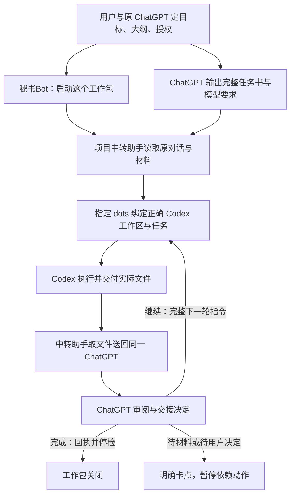

# ChatGPT → Grok BOT → dots → Codex → ChatGPT 审阅

让 ChatGPT 布置任务，让 Codex 交付文件，再把文件送回原 ChatGPT 审阅，由它决定继续修改还是完成工作包。

- **我只有 ChatGPT 和 Codex** → [动手做一次文件送审](docs/第一次送审.md)。你来传递文件，体验两轮修改。
- **我已有 Grok BOT 和 dots** → [配置自动交接](docs/从零上手.md)。dots 在这套流程中负责把任务交给指定工作区里的 Codex。
- **我已经配置好了，要开新项目** → [复制启动模板](templates/新项目启动模板.md)。

## 第一次使用

请先读 [从零上手教程](docs/从零上手.md)：下载工具包 → 让 Codex 带你配置 → 安装 skill → 检查连接 → 两轮教学演练。教程含可直接发给朋友 Codex 的首次引导提示词。

本仓库提供流程规范和模板；完整自动中转还需使用者具备 Grok BOT、dots 等服务与权限，尚未包含一键部署程序。

## 新项目怎么用

1. 打开 [新项目启动模板](templates/新项目启动模板.md)，填写四项：项目名称、目标对话、Codex 工作区、授权范围。目标对话一栏同时列出原 ChatGPT、dots 与秘书Bot 主对话；未知绑定由秘书Bot 发现后读回，不猜测。
2. 把模板第一段发给原 ChatGPT，先把目标、大纲与授权定清；让它生成项目卡与首轮完整任务书。
3. 把第二段发给秘书Bot：**启动这个工作包。** 秘书Bot 读取指定原对话，不需要用户逐轮复制提示词。
4. 等待秘书Bot 在用户可见的主对话报告送审、继续送达、卡点或最终结果。

安装与发现验证请按 [教程第 3 步](docs/从零上手.md#3-安装与验证-skill) 操作。安装不会自动获得 Grok BOT、dots 或 ChatGPT 权限，也不会自动创建定时器。

## 分工与可靠性

|角色|责任|
|---|---|
|用户 + 原 ChatGPT|确定目标、大纲、授权；ChatGPT 每轮写自包含任务书、选择适合的 Codex 模型和推理强度、审阅实际成果并决定下一步|
|秘书Bot|一次启动后安排本项目中转助手；在用户可见主对话主动报告关键变化，报完继续|
|中转助手|从指定原对话取完整任务书与材料，交给指定 dots；取回实际文件并送回同一对话；按交接动作路由|
|dots|确认项目、工作区、任务 ID；安排 Codex；逐轮记录请求值、可设置值、运行证实值|
|Codex|在授权内执行，产出文件、验证结果、提交号及证据；不得以自己的总结替代 ChatGPT 审阅|

项目绑定、交接字段、去重、轮询和回执规则见 [skill](skills/relay-research-review/SKILL.md)。模型或强度无法核实就写“未知”；不能把请求值当实际值。

等待交付或审阅默认每 **5 分钟** 检查，由有权限的 Grok BOT 创建并读回任务 ID、实际间隔与启用状态。正在生成就安静等待，完整结果出现就当场处理。没有权限或不能确认调度时报告卡点，不能声称已启动。无变化不汇报。

断线后先查询目标端接收记录，再决定是否补发；不确定时暂停发送并报告。用户未发送的草稿必须保留，遇到草稿可改用安全的新输入位置，无法保证则报卡点。

**工作包完成不等于整个项目可以提交。** 后者还须符合项目整体验收及提交授权。

## 简单例子与验证边界

虚构项目“晨光资料索引”：首轮生成索引，ChatGPT 发现分类需修改，末尾交接“继续”，中转助手原样传递完整第二轮任务书；第二轮文件审阅通过，交接“完成”，秘书Bot 回执并停检。详见 [两轮与断线示例](examples/两轮交接.md)。

运行 `python3 scripts/validate.py` 检查本地相对链接、技能基本格式、模板字段，以及两轮状态和已送达断线去重的模拟。它不连接真实 BOT，不证明真实调度或端到端运行成功。[验证记录](VALIDATION.md) 区分本地示例验证与实际发布证据。

仓库仅含虚构示例。真实对话链接、任务 ID、本机路径、课程材料、凭据、运行日志与用户草稿保留在各自私人项目，勿提交到工具包仓库（私有仓库也同样遵守）。
